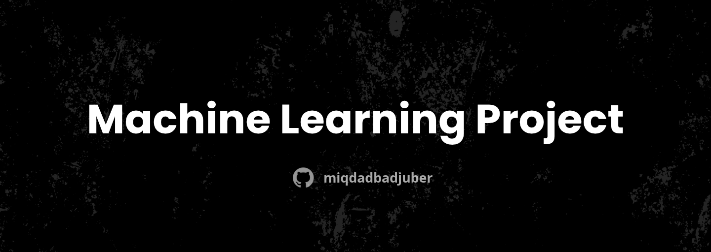

<div align="center">



# Student Performance MLOps


<p>Automated preprocessing, MLflow experiment tracking, and Docker CI/CD deployment for student academic performance prediction.</p>

</div>

---

## Overview

This project implements an automated machine learning operations (MLOps) pipeline designed to predict student academic performance categories (`GradeClass`) from behavioral, demographic, and academic indicators.

The repository consolidates experimental research into a production-style workflow: raw data preprocessing, automated train/test dataset generation, MLflow experiment logging, and a continuous delivery pipeline that validates model training and builds a containerized prediction service.

---

## Pipeline Architecture

```text
Student_performance_data_.csv
        |
        v
[1. Automated Preprocessing: automate_preprocessing.py]
  - Drops uninformative identifiers (StudentID)
  - Scales numerical features with StandardScaler
  - Generates stratified 80/20 train/test split
        |
        +---> student_performance_preprocessing/ (train.csv, test.csv, scaler.pkl)
        |
        v
[2. Experiment Tracking & Training: MLProject/modelling.py]
  - Standardized MLflow Project specification (MLproject, conda.yaml)
  - Trains RandomForestClassifier (100 estimators, random_state=42)
  - MLflow autologging for parameters, metrics, and model serialization
        |
        +---> mlruns/ (experiment registry)
        |
        v
[3. Automated CI/CD: .github/workflows/ci.yml]
  - Automated trigger on push to main branch
  - Executes MLflow training run in local environment
  - Commits updated experiment run artifacts
  - Builds and packages standalone model container via mlflow models build-docker
```

---

## Workflow Components

### 1. Automated Preprocessing (`automate_preprocessing.py`)
- Reads raw records from `Student_performance_data_.csv`.
- Normalizes continuous features (`Age`, `StudyTimeWeekly`, `Absences`, `GPA`) using `StandardScaler`.
- Performs a stratified split (80% training, 20% test) to preserve grade class balance.
- Exports clean datasets (`train.csv`, `test.csv`) and the fitted `scaler.pkl` to `student_performance_preprocessing/`.

### 2. Experiment Tracking & Modeling (`MLProject/`)
- Encapsulated as an MLflow project to guarantee reproducible execution across environments.
- Trains a `RandomForestClassifier` on the preprocessed training features.
- MLflow autolog captures run parameters, accuracy metrics, and the serialized model into the local registry.

### 3. Continuous Delivery (`.github/workflows/ci.yml`)
- Automates model retraining and packaging upon code updates.
- Uses MLflow CLI tooling to generate a self-contained Docker container image exposing the prediction interface.
- Validates end-to-end container build reproducibility on the CI runner.

### 4. Exploratory Data Analysis (`student_performance_experiment.ipynb`)
- Documents initial data exploration, feature distributions, correlation heatmaps, and early modeling experiments that shaped the final automated pipeline.

---

## Dataset

**Student Performance Dataset** (`Student_performance_data_.csv`)

| Feature | Description |
| :--- | :--- |
| Age | Student age |
| StudyTimeWeekly | Weekly study hours |
| Absences | Total class absences |
| GPA | Cumulative Grade Point Average |
| GradeClass | Target academic grade category |

---

## License

MIT: [LICENSE](LICENSE)
